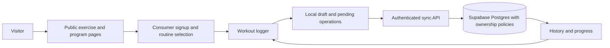

# IronSync: public workout app production plan

**Completed:** 23 October 2026 · **Research and checks:** 22–23 October 2026 · **Direction confirmed by owner:** public workout and exercise app · **Baseline commit:** ec874eb

**Recommendation:** Launch a mobile-friendly public exercise library and workout tracker for beginner and intermediate adult lifters. The core promise is: **“Know what to do, adapt it to your equipment, and keep every set.”** Keep the existing Next.js and Supabase foundation. First make discovery, onboarding, logging, and progress trustworthy; introduce advanced coaching after the training data is reliable.

Companion documents: [code audit and competitor research](D:/Projects/IronSync/docs/PRODUCTION_AUDIT.md) · [implementation backlog and acceptance criteria](D:/Projects/IronSync/docs/PRODUCTION_BACKLOG.md).

## 1. What the project is today

IronSync has substantial reusable work: a Next.js 15 / React 19 application, Supabase authentication and plan persistence, a deterministic plan engine, an exercise catalog, workout/nutrition interfaces, PDF exports, gym administration, and an Android Capacitor wrapper. It currently combines three different products: personal planning, gym operations, and a mobile demonstration.

It is **not ready for a public consumer launch**. The build succeeds, but a successful build does not establish that workouts persist, permissions isolate users, or exercise demonstrations are correct.

| Area | Observed state | Production decision |
| --- | --- | --- |
| Build foundation | TypeScript, lint, and production build pass; lint has image/font warnings | Retain stack; fix warnings that affect release routes and update vulnerable dependencies |
| Consumer access | Middleware redirects anonymous onboarding and dashboard requests to gym-member login | Restore a consumer signup, onboarding, and dashboard journey |
| Workout execution | Mobile logger uses fixed exercises, component state, and a timer starting at 42:18 | Build real sessions and set persistence; use the visual components as a starting point |
| Exercise content | 168 unique catalog IDs; all video URLs point to two Google sample clips; mobile search claims 420+ | Publish only reviewed entries with matching demonstrations and accurate counts |
| Personalization | Rules-based split generator; experience parameter is unused; session length is not supplied to workout selection | Add explicit equipment/time constraints and trainer-reviewed progression rules |
| Data access | Several migrations contain unrestricted RLS policies; admin lookup errors can permit authenticated users | Resolve before opening consumer registration |
| Mobile extras | Readiness, wearable connections, AI synthesis, and some authentication actions are demonstrations | Hide incomplete controls in release builds; retain clearly isolated demos for development |
| Measurement | Analytics defaults to browser/session buffers; no external provider registration found | Add privacy-aware central events and operational monitoring |
| Release discipline | Scratch QA scripts exist; no package test command or checked-in CI workflow found | Turn relevant checks into repeatable CI plus database and browser tests |

The audit documents source locations, verification results, and what was not tested. Live database grants, authenticated user flows, deployed configuration, and Android release behavior remain unverified.

## 2. Product focus and assumptions

**First audience:** adults beginning or maintaining strength training who want to understand movements, follow a repeatable routine, and see their own progress. Start with commercial gyms, dumbbells/bench at home, and bodyweight setups. Support kilograms and pounds from day one.

**First job to solve:** “I have limited time and this equipment. Show me a suitable workout, help me understand each movement, and remember what I did so the next session is easier to plan.”

**Product position:** a straightforward bridge from exercise learning to actual training history. Equipment availability, continuity across sessions, and clear explanations are the initial differentiators to test. Competitors already offer logging, libraries, and personalization, so these features alone do not establish a market advantage.

**Working assumptions, not confirmed market facts:** mobile web is the fastest useful first distribution channel; English is the first content language; users can train without a paid subscription; a smaller reviewed catalog is sufficient for a closed beta. Geography, budget, team size, existing consumer traffic, and willingness to pay have not been established. Hindi/Hinglish content is a later experiment if interviews support it, not an assumed requirement.

**Launch boundaries:** general adult fitness only. Nutrition prescriptions, rehabilitation, youth programs, medical assessment, calorie-burn precision claims, and biometric recovery scores require separate content and product validation. Existing nutrition code can be retained without being a launch dependency.

## 3. Problems worth solving and the evidence

These are research signals and testable hypotheses. Public comments are self-selected anecdotes, not prevalence estimates or proof that a competitor still has the reported issue.

| Problem | Evidence | IronSync response | Validation |
| --- | --- | --- | --- |
| Equipment recommendations do not match reality | A Fitbod user reported an exercise missing required equipment metadata; other users described replacements when traveling ([discussion](https://www.reddit.com/r/fitbod/comments/1j8x03o)) | Model complete equipment requirements, quantity, and available load increments; offer explained alternatives | Observe users building workouts in 3 real equipment setups; every required item must be available |
| Beginners struggle to connect terminology and equipment to their session | A beginner described confusion about equipment within a suggested split ([discussion](https://www.reddit.com/r/beginnerfitness/comments/1vrz44p/confused_about_all_the_equipments/)); ACE organizes instruction by body part, equipment, and difficulty ([library](https://www.acefitness.org/resources/everyone/exercise-library/)) | Plain-language cues, correct demonstration, equipment photos where licensed, and search aliases | At least 8 of 10 observed users find an exercise and explain its setup without moderator help |
| Switching apps can strand training history | Hevy documents specific Strong CSV import requirements, including English and kilogram data ([official help](https://help.hevyapp.com/hc/en-us/articles/38001424401943-How-to-Import-Strong-App-CSV-Files-and-Export-Your-Data-in-Hevy)) | Free export at launch; a previewed, reversible Strong CSV importer after beta | Import fixtures preserve units, dates, sets, and unmapped exercise names; repeat import creates no duplicates |
| Logging needs to be fast and dependable | Strong centers its product on simple logging and export; Hevy highlights rest timers and exercise history ([Strong](https://www.strong.app/), [Hevy](https://www.hevyapp.com/)) | Previous-set values, large controls, recoverable drafts, visible sync status | Measure time to log a set and verify recovery after refresh, screen lock, and disconnection |
| Plans should respect time and avoid unexplained changes | Fitbod documents duration/equipment inputs and recommendation regeneration ([official help](https://help.fitbod.me/hc/en-us/sections/360001078993-How-Fitbod-Works)); IronSync currently ignores experience in its split function | Stable plan versions, time budgeting, explanations, and optional changes | No completed history changes when a routine changes; users can explain a proposed adjustment |
| Users need value before paying | Boostcamp publishes a substantial free program/tracking offer; Nike supplies free training guidance ([Boostcamp](https://www.boostcamp.app/free-workout-app), [Nike](https://www.nike.com/ntc-app)) | Useful free library and logging; charge later for validated advanced value | Interview engaged users and test a clearly priced offer after they have completed several sessions |

**Week-one discovery:** recruit 12–15 people: roughly half new lifters, several established app users, and several training with limited equipment. Observe actual tasks, with permission, rather than asking only whether they like the idea. Ask them to show their last workout, demonstrate how they replace an unavailable exercise, and explain how they decide their next weight. Record task success, time, confusion, and workarounds. Recruit 2 qualified trainers to review content and templates. Recruitment and interviews are proposed work; they have not happened in this analysis.

Proceed when several independent users demonstrate the same material problem and a small prototype helps them complete it. If the main need is different, adjust scope before building advanced personalization.

## 4. Competitive strategy

| Reference | Observed strengths | What to learn | IronSync choice |
| --- | --- | --- | --- |
| [Hevy](https://www.hevyapp.com/) | Workout logging, routines, records, history, exercise videos, social features | Make repeated logging quick and progress understandable | Match reliable core logging; defer social feeds |
| [Strong](https://www.strong.app/) | Simple training journal, charts, cross-device access, data export | Reduce interaction cost during a workout | Prioritize speed, ownership of history, and easy export |
| [Fitbod](https://fitbod.me/) | Goal, experience, and equipment-based workout recommendations; adapts using logged training | Tie recommendations to actual constraints and history | Begin with reviewed rules and explicit reasons; validate before expanding AI |
| [JEFIT](https://www.jefit.com/use-case/workout-planner) | Exercise catalog and customizable workout templates | Connect discovery directly to routine building | Search by everyday language, then add to a routine in one action |
| [Boostcamp](https://www.boostcamp.app/free-workout-app) | Structured programs with a broad free tracking offering | Users can expect useful programs without paying immediately | Offer a small, well-reviewed starter library and clear free value |
| [MuscleWiki](https://musclewiki.com/) | Public exercise library with interactive muscle map | Visual exercise discovery | Provide a text/list alternative as well as visual navigation |
| [ACE](https://www.acefitness.org/resources/everyone/exercise-library/) | Exercise descriptions, photos, equipment/difficulty organization | Instruction quality and taxonomy | Have a trainer review each published movement and its demonstration |
| [Nike Training Club](https://www.nike.com/ntc-app) | Free guided workouts and programs across several training styles | Beginner-friendly language and approachable entry points | Keep the first session simple and optional onboarding short |

These observations come from official public pages checked on the preparation date, not paid-product walkthroughs. Prices, platform parity, and feature restrictions were not comprehensively verified. Use these sites as design and content references; do not copy their videos, photographs, programs, or proprietary databases without permission.

## 5. The complete first-release experience

### Public discovery

Public pages: home, exercise directory, individual exercise pages, program directory, program details, help, privacy, and terms. Browsing does not require login. Every exercise has a stable URL and an obvious “Add to routine” action. Search accepts names and aliases; filters cover equipment, body area, difficulty, and movement pattern. Counts come from published records, never hard-coded marketing copy.

An exercise page includes a matching short video or photo sequence, concise setup and movement instructions, common mistakes, primary and secondary muscles, required equipment, reviewed alternatives, reviewer/date, and a report-content-error action. Use plain words first, anatomical terms second.

### Account and onboarding

Offer email authentication first, with verified email and real password recovery. Add Google sign-in once callback handling is tested. Keep gym ID/PIN authentication separate from public consumers. Ask only training goal, experience, schedule, session length, equipment, and preferred units to recommend a starting routine; body measurements and nutrition questions are optional and deferred.

Allow a visitor to preview a routine before creating an account. Require an account to synchronize and retain training history. Preserve the selected routine across signup. Incomplete profiles should be recoverable; returning users should land on their next workout, not repeat onboarding.

### Routine and workout

Choose a reviewed template or create a custom routine. Show estimated duration with its assumptions. Before starting, show equipment requirements and the last relevant performance. During training, log weight/reps or time/distance as appropriate, mark warm-up versus working sets, add notes, and use a rest timer. RPE/RIR can be optional advanced inputs.

Offer “equipment unavailable,” “short on time,” and “skip” actions. Substitutions must satisfy the required equipment and movement constraints; they must not silently reuse the previous exercise's suggested load. A change applies to this session unless the user explicitly updates the routine.

After every change, save a local draft and show whether it has synchronized. Closing the tab, refreshing, or temporarily losing service must not discard the session. A visible finish action gives a truthful summary and preserves history. A rest day is valid and should not be described as failure.

### Progress and return visits

Show completed sessions per week, exercise-specific history, comparable personal records, and load/rep trends. Clearly state unit and calculation conventions. Distinguish planned exercise from performed exercise, and gym attendance from completed workouts. An empty account shows an empty state, not sample streaks or physiology scores.

Let users edit mistaken entries, export their history, choose reminder preferences, and delete their account through a real server workflow. Changes to programs must never rewrite historical performance.

### Navigation

Use five primary destinations: **Today, Exercises, Routines, Progress, Profile**. Desktop uses the same data and route structure as mobile. Move AI behind a contextual help control only after the launch core is complete. Preserve the existing visual identity while simplifying unclear labels such as “synthesize,” “recruit,” or unsupported recovery percentages.

## 6. Scope and rollout

| Release | Included | Intentionally deferred |
| --- | --- | --- |
| Closed beta | Consumer auth; reviewed exercise subset; search; 6–8 starter templates; custom routines; real set logging; local recovery and sync; basic history; export/delete; monitoring | Payments, external imports, wearables, social feed, generative plans, nutrition prescriptions |
| Public free release | Beta fixes; 80–120 reviewed exercise entries if content capacity permits; search indexing; help/support; reliable installation and previously cached offline workout use | Native app store release unless device checks are complete |
| After retention evidence | Strong CSV import, expanded programs, richer charts, optional paid tier | Broad AI coaching, health platform integrations, creator marketplace |

Content count is an editorial target, not a launch promise: begin with 40–60 reviewed movements for beta and expand only as each asset is approved. All exercises used by launch templates must be published and reviewed. If funding or staffing is smaller, reduce catalog breadth and template count before reducing data safety or logging reliability.

## 7. Technical design

Retain Next.js, React, Tailwind, and Supabase. Use one consumer data model and shared feature services for web and mobile. Consolidate duplicate Supabase helpers gradually. Avoid a full rewrite or a second backend before a concrete need appears.

Public exercise and program pages can be rendered on the server and cached. User sessions, workouts, exports, and account actions need authenticated access and private cache behavior. Route guards improve navigation, but authorization must also happen at each API/database boundary. See the official [Next.js production checklist](https://nextjs.org/docs/app/guides/production-checklist) and [Supabase RLS guidance](https://supabase.com/docs/guides/database/postgres/row-level-security).

### Proposed data model

| Entity | Essential fields and rules |
| --- | --- |
| profiles | Auth user ID as canonical identity, display name, units, timezone, onboarding state, preferences; resolve the existing redundant id/user_id ownership model |
| exercises | Stable ID/slug, aliases, equipment requirements, pattern, muscles, difficulty, instructions, reviewer, publication state, content version |
| exercise_media | Exercise ID, approved asset URL, asset type, rights holder/license record, captions, review date; public access only for approved assets |
| equipment_profiles | User ID, named location, available equipment/quantities, load increments, update timestamp |
| programs / program_versions | Public template metadata, immutable reviewed versions, goal, schedule and duration guidance |
| routines / routine_exercises | User-owned routine and ordered exercise prescription; revision; structured sets/reps/rest rather than display strings alone |
| workout_sessions | User ID, routine/version reference, status, UTC timestamps, local timezone, device ID, revision, summary derived from performed sets |
| workout_exercises | Session ID, exercise ID plus name/content snapshot, order, substitution reference and reason |
| workout_sets | Stable client-generated UUID, session/exercise owner linkage, set type, load + unit, reps/time/distance, completion, optional effort rating, revision |
| sync_operations | Unique (user_id, operation_id), payload hash, applied revision and result; retrying identical operations returns the same result |
| consent_preferences / deletion_jobs | Notification/analytics choices, account-deletion progress, minimal operational evidence |
| entitlements / billing_events | Later: verified provider IDs, plan status, event deduplication; no client-authoritative paid status |

Use foreign keys and ownership constraints so a user cannot attach a set to somebody else's session. Index session history by user/date and sets by session/order. Maintain a documented retention policy for tombstones and operation receipts. Search can start with normalized aliases and Postgres text search; introduce a search service only when measured quality or performance warrants it.

### Proposed API contracts

| Contract | Required behavior |
| --- | --- |
| GET /api/exercises | Published catalog only; paginated filters; stable IDs and content versions |
| POST /api/routines | Validated prescription; authenticated owner assigned server-side |
| POST /api/workout-sessions | Create or recover a session using a client-generated idempotency key |
| POST /api/workout-sessions/:id/operations | Bounded batch; ownership checks; validation; per-operation acknowledgement; revision conflicts returned explicitly |
| POST /api/workout-sessions/:id/complete | Atomic completion; recomputed summary; repeat request returns the same completed record |
| GET /api/workout-history | Paginated owner-only history; timezone-aware filters |
| POST /api/account/export | Reauthentication where appropriate; safe CSV/JSON export; private expiring download |
| DELETE /api/account | Reauthenticate, revoke access, delete owned data and identity through a server workflow; expose retryable status |
| POST /api/billing/webhook | Later: verify signature, deduplicate events, reconcile entitlement states |

These routes are proposed contracts; they do not exist as implemented features yet. A typed validation layer should reject oversized payloads, invalid units, impossible negative values, and unsupported state transitions without corrupting the active workout.

### Offline and conflict behavior

Use IndexedDB for user-scoped drafts and an operation queue. Persist locally before displaying a saved state; show “saved on this device” separately from “synced.” A service worker should cache only the app shell and chosen public content, not authenticated API responses. Offline first-open is not promised; previously loaded workouts should reopen offline.

Assign UUIDs to sessions, sets, and operations. Retrying a finished session must not double-count records or weekly totals. Use revisions and a 409 conflict response for concurrent edits to the same set. Merge independent new sets; ask the user to choose when the same set has conflicting edits. Do not silently use last-write-wins for completed workout data. Keep deletion tombstones long enough to avoid resurrecting removed sets during delayed sync.

Use timestamps for elapsed workout/rest time so background suspension does not depend on interval ticks. Clearly explain that browser storage can be cleared or evicted and provide sync/export controls. Log out must isolate the next account; warn about unsynced work before clearing an account's draft.

### Migration and legacy areas

Inventory the deployed schema and make a verified backup before applying migrations. Establish one reproducible baseline and ordered migrations; do not assume the current SQL files have all been applied. Add consumer tables and policies alongside existing gym records. Backfill IDs and ownership, reconcile counts, and test two consumer accounts plus an admin before switching routes.

Keep gym operations access behind explicit authorization while the owner decides whether to maintain that separate product. Removing navigation alone does not secure its APIs or tables. Keep old plan data readable through an adapter during migration; retire unused paths after data and user-flow verification. Use additive migrations and feature flags so app rollback does not require destructive database rollback.

## 8. Security, content, and operational release gates

**Identity and access:** admin lookup failures deny access. Consumer identity never comes from editable user metadata. Every private table has explicit grants and row ownership checks. Test anonymous, own-user, other-user, and admin requests directly against APIs and Supabase. For the public app, use Supabase Auth rather than expanding the custom 4-digit gym PIN system. If legacy member login remains exposed, give it shared durable throttling and revocable sessions.

**Content:** publish only correct, rights-cleared exercise media. Retire sample video URLs and unverified movement/calorie/recovery claims. Keep each entry's review record, content version, and reporting mechanism. Trainer review must cover equipment, instructions, substitutions, and beginner suitability. Generated imagery is not a substitute for a reviewed movement demonstration.

**AI:** keep it out of the critical workout path. Before enabling existing coach routes publicly, require authenticated access, durable quotas, bounded request size/history, timeouts, a spending limit, and a clear unavailable state. Retrieve approved content and real user context server-side. Treat model output as suggestions requiring confirmation; never silently change a plan. Test harmful or inappropriate advice handling and make the AI nature clear.

**Operations:** separate development, staging, and production; isolate credentials and data. Add CI for type/lint/build, critical domain tests, database policy tests, and browser flows. Record a release version, use request IDs, redact logs, configure error alerts, and keep a named support/on-call owner. Exercise backup restoration into staging and measure recovery time.

**Privacy:** make workout history private by default. Limit collection to useful inputs. Keep body measurements, notes, and medical text out of analytics. Provide working export/delete actions, a truthful privacy notice, support contact, and a retention schedule. Have the launch-market privacy and payment obligations reviewed before charging or expanding data collection; this plan is not a legal compliance determination.

**Performance/accessibility targets, proposed:** p75 LCP <=2.5 seconds, INP <=200 ms, CLS <=0.1 on measured release routes; 44px workout controls where practicable; accessible labels, keyboard access, captions, reduced motion, and readable contrast. Test on a representative low-cost Android phone as well as current iOS Safari and desktop browsers. Use lazy media and screen loading to reduce the current mobile bundle; do not infer real-device performance solely from build sizes.

**Reliability targets, proposed:** no lost or duplicate sets in the offline/retry test suite; >=99.5% successful sync operations while online excluding invalid/auth-expired requests; p95 online set acknowledgement <1 second under the agreed pilot load; 99.5% monthly service availability initial objective. Acknowledge local saves separately so a slow network does not block logging. Draft target RPO <=1 hour and RTO <=4 hours, then select and test backup/recovery capabilities that actually meet them; revise the promises if budget cannot support them.

## 9. Delivery roadmap

**Planning assumption:** 2 full-time developers, a part-time designer/researcher, a trainer/content reviewer, and part-time QA. Target 12 weeks to a gated public free release; allow 2 additional weeks if content or pilot reliability slips. A solo developer should budget roughly 20–26 weeks for the same scope. These are estimates, not delivery commitments.

| Phase | Timing | Main output | Exit condition |
| --- | --- | --- | --- |
| Validate and contain | Week 1 | Interviews, route map, schema/grant inventory, content inventory, admin/RLS fixes, dependency triage | No known broad-access policy or fail-open authorization remains in staging; audience problem documented |
| Consumer foundation | Weeks 2–3 | Consumer auth, onboarding, data contracts, baseline migrations, central telemetry, CI | Visitor signs up, returns to selected routine, and only sees their own data |
| Learn and plan | Weeks 3–5 | Public catalog, reviewed media, search, templates, custom routines, equipment constraints | Users can select an achievable routine; all template movements have approved content |
| Train and retain | Weeks 5–8 | Sessions/sets, timer, draft recovery, offline queue, safe completion, substitutions, history | A full session survives reload, disconnection, retries, and second-device viewing |
| Closed beta | Weeks 9–10 | 30–50 consenting users; support; analytics; export/delete; accessibility and device fixes | Critical bugs resolved; observed task success and sync gates pass |
| Public readiness | Weeks 11–12 | Expanded reviewed content, SEO, help, load test, backup drill, production runbook | Release checklist signed off; ongoing support owner assigned |
| Learn before monetizing | After release | Four-week retention cohorts, import pilot, paid-value experiments | Retention and willingness-to-pay evidence justify the next investment |

Content production begins in week 1 and runs alongside engineering. It is a separate capacity constraint. The critical path is **access control → consumer identity/data model → real logging → sync/history → beta evidence → launch**. Publish neither a paid tier nor app-store claims simply because a calendar date has arrived.

## 10. Prioritized work and first sprint

The [backlog](D:/Projects/IronSync/docs/PRODUCTION_BACKLOG.md) contains 20 release tasks with dependencies and testable acceptance criteria. P0 means a release blocker; P1 means required for a useful public product; P2 means follow-up after validation.

**First 10 working days:**

1. Confirm one consumer route and identity model; document old gym paths and migration ownership.
2. Inventory live grants/policies; fix overly permissive policies and admin failure behavior; verify a two-account access matrix in staging.
3. Patch dependencies after reviewing advisory applicability; establish CI and a repeatable database baseline.
4. Replace the mobile demo entry with an explicitly isolated development mode; wire real consumer login/recovery and onboarding.
5. Define exercise IDs, routine versions, workout sessions, sets, and sync operations; prototype one exercise with persistent set logging.
6. Review 10 representative exercise entries and record correct sample media; observe users searching and logging.

**Sprint demo:** a public visitor chooses a reviewed movement, creates an account, saves a small routine, logs a set, refreshes, and sees the same value. A different user cannot read or alter it. This is the first vertical slice, not the full launch.

## 11. Measurement and validation

All targets below are initial decision thresholds, not industry benchmarks or promises.

| Metric | Definition | Initial decision threshold |
| --- | --- | --- |
| Activation | New verified users completing a workout with at least one working set within 7 days / eligible new verified users | >=40% in the first observed beta cohort; inspect failure reasons, not just the percentage |
| First-value usability | Observed users able to choose a routine and log a first set without help | >=8/10; report participant count and device mix |
| Logging speed | Median time to record and complete a set after the exercise is open | <=10 seconds in observed tests |
| Training engagement | Weekly distinct users completing at least 2 workouts | Primary ongoing usage measure; report count and cohort |
| Four-week retention | Activated users with a completed session on days 22–28 after activation / activated users with full observation | Initial target >=25%; small samples are directional only |
| Content usefulness | Exercise-helpfulness responses and verified content issue rate | Resolve all critical form/media errors before wider distribution |
| Sync reliability | Acknowledged operations / valid online operations; track pending queue age separately | >=99.5%, zero known data-loss defects |
| Support burden | Issues per 100 weekly active users and time to first response | Establish baseline; respond within 1 business day during beta |

Record catalog_viewed, exercise_viewed, search_performed, routine_selected, signup_completed, workout_started, set_completed, workout_completed, sync_failed, exercise_swapped, and export_completed. Use pseudonymous account IDs where justified, omit free-text notes and health measurements, and honor consent settings. Operational error monitoring and optional product analytics need separate retention and access rules.

Segment by new/experienced users, equipment setup, platform, and acquisition source only where sample size supports interpretation. Interview users who stop after the first session. Retention improvement should guide expansion into social or AI features.

## 12. Monetization, costs, and acquisition

**Start free:** approved exercise library, core routine building, unlimited basic logging, history, basic trends, and data export. Test payment only after users experience repeat value. Candidate paid value: richer trend analysis, advanced program customization, and reviewed specialty programs. Keep access to existing history and export after cancellation. Do not create paid entitlements based only on a checkout redirect.

**Pricing experiment:** present clearly labeled concepts to engaged users in the actual target market; test monthly versus annual interest after interviewing them. No final price is justified by the current evidence. Launch geography must precede currency, payment-provider, tax, and refund decisions. Paid checkout needs separate acceptance tests for failed, duplicate, delayed, refunded, and canceled payments.

**Budget method:** estimate 82–105 engineering days across the release backlog, including task-level testing and review, plus separately staffed research/content/QA work and 15–25% contingency if scope is uncertain. With two developers, 12 weeks offers 120 nominal developer-days; reserve roughly 25% for coordination, review, support, and unplanned fixes, leaving about 90 delivery days. These are approximate capacity allowances, not extra hours to bill twice. If work estimates trend above that capacity, use the contingency weeks or reduce scope.

Illustrative cost model, not vendor quotes: total launch cost = engineering days × actual blended day rate + designer/researcher days × rate + reviewed exercise assets × contracted asset cost + QA/security review + operating services + contingency. Track hosting, database/backups, media delivery, authentication email, telemetry, and support separately. AI cost is zero for the core beta if disabled.

For capacity estimation only: 1,000 monthly active users × 12 sessions/month × 20 logged sets/session yields 240,000 set records/month. At an assumed 1 KiB per record that is about 234 MiB of raw set payload before indexes, WAL, backups, and other data. Ten 1 MiB clip deliveries/session would add about 117 GiB/month of media transfer before caching effects. Measure real media sizes and reuse; video delivery can exceed row-storage cost. Reprice providers against the final region, retention, and traffic model before deployment.

**Acquisition sequence:** publish useful original exercise/program pages; recruit a small community through permission-based trainer relationships; create short approved demonstrations; add shareable routine links without exposing private workout history. Validate retention before paid acquisition. Avoid thin autogenerated SEO pages. The ability to move users from a useful exercise page into their first completed workout is the primary acquisition funnel.

## 13. Launch decision and open questions

Public launch requires: owner-only private data access; working consumer signup/recovery; correct exercise content; real persistent logging; offline/retry recovery; truthful progress; export/delete; monitored errors; tested restoration; support contact; and a completed pilot. Payments and app-store packaging have additional gates if included.

Outstanding decisions: launch geography/language, team capacity, monthly operating ceiling, ownership/licensing of exercise assets, whether existing gym customers require ongoing support, and whether mobile web is sufficient for the initial cohort. They affect estimates and scope, but do not prevent starting the security fixes, content inventory, and consumer logging foundation.

**Recommended next implementation milestone:** deliver the first authenticated, persistent workout session with reviewed exercise content and verified user isolation. That makes the rest of the public app measurable and testable.
